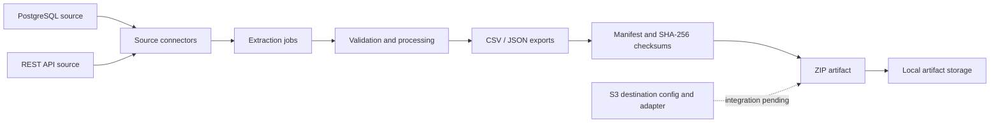

<!--
  GitHub profile portfolio
  Visual assets will be added after the matching illustration pack is delivered.
-->

# Daniel Núñez Ortiz

### Data Engineer · Analytics Engineer · Software Developer

**Curious by nature.**

I build data pipelines, backend services and analytical workflows — with a focus on practical systems that solve real problems.

Valencia, Spain · Open to remote opportunities

[LinkedIn](https://www.linkedin.com/in/daniel-nunez-ortiz/) · [GitHub](https://github.com/DanielNuOrt) · [Email](mailto:danielnuort@gmail.com)

  
   
  

  
  
  
  

[Explore the work ↓](#selected-work) · [Engineering approach](#how-i-approach-engineering) · [Background](#background)

---

## The short version

I work across the data and software lifecycle: connecting source systems, shaping and validating data, building APIs and services, and making information useful to the people who rely on it.

My experience spans data engineering, analytics and Ruby on Rails development. I enjoy understanding the problem behind a system, then building something clear, maintainable and useful.

| DATA ENGINEERING | SOFTWARE DEVELOPMENT | ANALYTICS |
|:--|:--|:--|
| Python · SQL · Airflow · ETL/ELT · BigQuery · Druid | Ruby on Rails · FastAPI · REST APIs · PostgreSQL · SwiftUI | Tableau · Superset · Data preparation · Reporting |

## Selected work

A few projects that represent the kind of problems I like working on — from data delivery and SaaS applications to native desktop software.

### 01 / DataRelay

**A data integration and delivery platform**

Python · FastAPI · PostgreSQL · Celery · Redis · Docker

DataRelay is an actively developed platform for tenant-scoped data extraction and export. It brings together source connectors, asynchronous processing, validation and packaged data artifacts.

Work to date includes API-key authentication, PostgreSQL and REST API source connectors, transactional job handling, export packaging, manifests and SHA-256 checksums. A provider-neutral S3 storage adapter and destination configuration are also in place, but end-to-end S3 delivery through the export worker is not yet complete.

**A look at the system**

DataRelay is currently a private development repository.

### 02 / Verifacto

**Invoicing software for Spanish freelancers and small businesses**

Ruby on Rails 8.1 · PostgreSQL · Hotwire · Stripe · AEAT XML / SOAP

A SaaS invoicing application co-developed with a partner and being prepared for pre-production. The work includes application workflows and VeriFactu-related functionality, including SHA-256 invoice-chain logic and integration with the Spanish tax authority's XML/SOAP services.

Co-developed project; not currently presented as a public GitHub repository.

### 03 / Orbit

**A native macOS AI assistant**

Swift · SwiftUI · Ollama · Streaming APIs

A macOS application exploring local and cloud model integration, streaming communication and desktop application design. The project combines a native SwiftUI interface with local model workflows and connected AI services.

Under active local development; the GitHub repository is not yet populated.

---

## How I approach engineering

<table>
  <tr>
    <td width="33%" valign="top">

**01 — Understand the data**

Start with the source, the shape of the data and the people who depend on it. Make assumptions visible and data quality measurable.

</td>
    <td width="33%" valign="top">

**02 — Build for reliability**

Prefer explicit interfaces, predictable processing, clear failure handling and systems that can be understood and maintained.

</td>
    <td width="33%" valign="top">

**03 — Deliver something useful**

A pipeline, API or dashboard matters when it improves a real workflow. Keep the implementation connected to the outcome.

</td>
  </tr>
</table>

### Tools and technologies

**Data engineering**

**Backend and application development**

**Infrastructure, visualisation and workflow**

---

## Analytics foundations

These case studies and learning projects were where I built my foundations in data analysis. They cover spreadsheet analysis, SQL, Python, data preparation, statistical analysis and Tableau storytelling.

These are study and portfolio projects, not commercial client engagements.

<strong>Influenza trends and forecasting</strong> · Tableau

A medical-staffing case study using historical influenza deaths and population data to explore seasonal patterns and workforce-planning needs across US states.

- Business-requirement translation, data cleaning and integration, transformation, hypothesis testing, visual analysis and forecasting.
- [Explore the Tableau story](https://public.tableau.com/app/profile/daniel7968/viz/InfluenzaAnalysis2018Forecast/Story1?publish=yes)

<strong>International homicide and drug-seizure analysis</strong> · Python / Tableau

An exploratory study of European intentional-homicide data and drug seizures. It examines a possible relationship between the measures; it does not establish causation.

- Data cleaning, integration and transformation, hypothesis testing, time-series analysis and visual storytelling.
- [Explore the Tableau story](https://public.tableau.com/app/profile/daniel7968/viz/6_7workinprogress/Story1?publish=yes)

<strong>Instacart Basket Analysis</strong> · Python / Jupyter

Exploration of grocery-order patterns and customer behaviour, including order timing, product and department trends, and customer segmentation.

- Data wrangling, merging, derived variables, grouping, aggregation, visualisation and Excel reporting.
- [View the repository](https://github.com/DanielNuOrt/Instacart-online-store) · [Presentation (PDF)](https://github.com/DanielNuOrt/DanielNuOrt/blob/main/Instacard%20Presentation.pdf)

<strong>Rockbuster Stealth</strong> · PostgreSQL / Tableau

Business analysis for a fictional movie-rental company considering the launch of an online video service.

- SQL joins, grouping, descriptive analysis and communicating business findings.
- [View the repository](https://github.com/DanielNuOrt/SQL-Rockbuster) · [Tableau story](https://public.tableau.com/app/profile/daniel7968/viz/RockbusterStealthLLCProject/Story1)

<strong>GameCo</strong> · Excel

Descriptive analysis of historical video-game sales, exploring market patterns to inform a fictional company's marketing strategy.

- Grouping and summarising data, descriptive analysis, visualisation and presentation.
- [View the repository](https://github.com/DanielNuOrt/GameCo) · [Presentation (PDF)](https://github.com/DanielNuOrt/DanielNuOrt/blob/main/GameCo_FinaL_Daniel.pdf)

---

## Background

Before moving into software and data, I spent around a decade working in hospitality and operations. That experience still informs how I approach engineering: understand the people and process behind the problem, keep things practical, communicate clearly and take responsibility for the result.

My path into technology has moved through analytics, full-stack development and data engineering. Each stage has added another perspective on how software, data and business processes fit together.

---

**Thanks for taking a look.** 🐾

[Connect on LinkedIn](https://www.linkedin.com/in/daniel-nunez-ortiz/)

